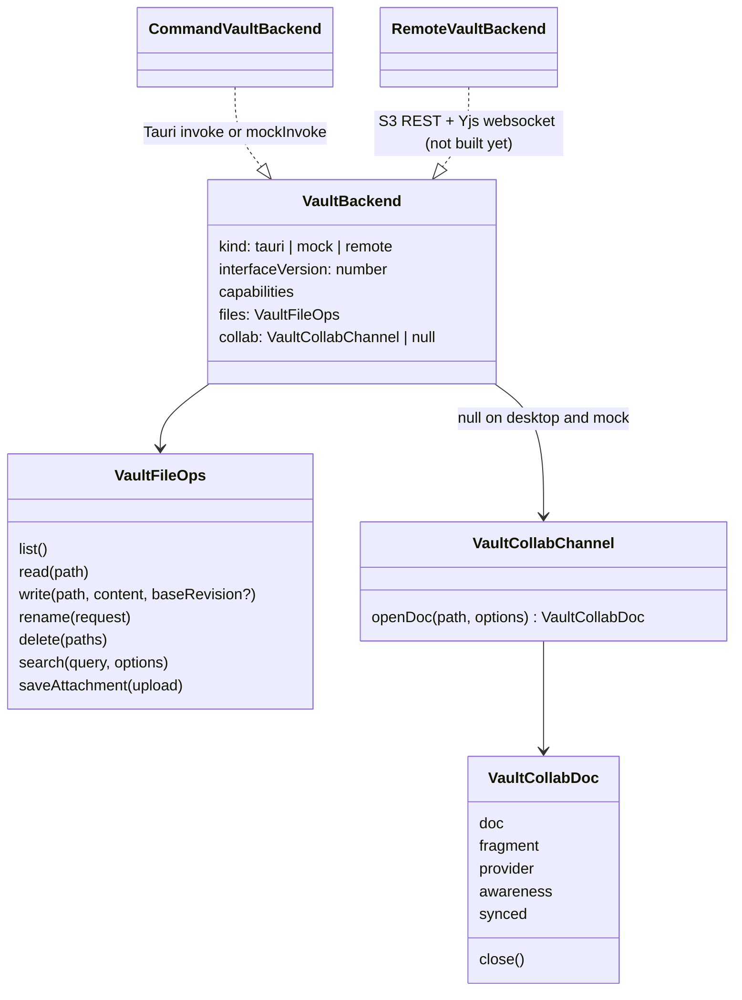
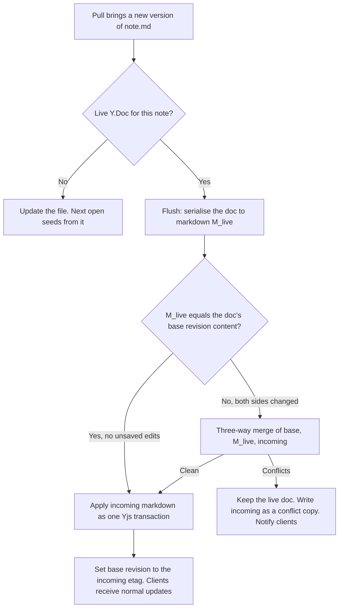

# Tolaria Web S1: Tauri inventory, VaultBackend, and what S3 must serve

Spike S1 (TOL-3, TOL-4), 12 Oct 2026. Measured on `origin/main` at `063149c7`.

This document answers four questions:

1. What does the shell ask the native side for today, and what does the web do about each call?
2. What is the `VaultBackend` seam and how does the app migrate onto it?
3. What does enabling BlockNote collaboration (Yjs) change in the shell?
4. What should the S3 file/sync server (TOL-5) expose?

## Headline numbers

| Measure | Count |
|---|---|
| Tauri commands registered in `src-tauri/src/lib.rs` | 116 |
| Commands the web client needs an answer for (vault, settings) | 45 |
| Commands that are desktop-only or replaced by a browser API | 71 |
| Registered commands with no caller in `src/` | 6 |
| `invoke(...)` call sites in `src/` (non-test, outside `mock-tauri/`) | 103 |
| `mockInvoke(...)` call sites in `src/` (non-test) | 56 |
| Files containing those call sites | 69 |
| `isTauri()` call sites in `src/` (non-test) | 129, in 76 files |
| Files mentioning `isTauri` at all (tests included) | 159 |
| Mock handlers in `src/mock-tauri/mock-handlers.ts` | about 134 |
| `@tauri-apps/*` import sites | `api/core` 80, `api/event` 12, `api/window` 11, `api/webview` 5, `plugin-dialog` 2, `api/dpi` 1, `plugin-opener` 1, `plugin-process` 1, `plugin-deep-link` 1 |

The 6 unused commands are `batch_archive_notes`, `delete_note`, `get_conflict_mode`, `get_startup_trace`, `migrate_is_a_to_type` and `sync_note_title`.

Counts were produced by scanning `generate_handler!` and `src/**/*.{ts,tsx}`; rerun the scan when the number matters, because `main` moves daily.

### What the numbers mean

- The shell does not call Tauri through one seam. Almost every call site is a local `isTauri() ? invoke(...) : mockInvoke(...)` branch, sometimes with different argument casing per branch (`rename_note` takes `{ args: { vaultPath, oldPath, ... } }` on Tauri and `{ vault_path, old_path, ... }` in the mock).
- The good news is that the branch already exists everywhere. The browser path is complete enough that the whole shell renders, opens notes and edits them with no Tauri runtime (see [Static web build](#static-web-build-tol-3)).
- The vault logic that matters (frontmatter parsing, entry derivation, search, rename with wikilink rewriting) is Rust, in `src-tauri/src/vault/`, `src-tauri/src/frontmatter/` and `src-tauri/src/search.rs`: about 15,500 lines including tests, with **no `tauri::` imports** and only three references to `crate::git`. It can be extracted into a Tauri-free crate.

## Web strategy vocabulary

| Strategy | Meaning |
|---|---|
| Remote REST | A call on the S3 file API |
| Remote Yjs | Goes through the collaborative document channel instead of a file write |
| Server reuse | The server runs the same Rust logic (extracted crate, called as a CLI or library). No WASM in M1 |
| TS port | Logic reimplemented in TypeScript in the client or a shared package |
| Client-local | Browser storage or a browser API; no server involved |
| Drop | Not needed on the web |

## In-scope commands (45)

"Rust-only" means the behaviour lives in Rust today and has no equivalent TypeScript implementation that the shipped app relies on.

### List and read the vault (5)

| Command | Purpose | Rust-only logic | Web strategy |
|---|---|---|---|
| `list_vault` | Scan the vault and return every `VaultEntry` (title, type, frontmatter-derived fields, snippet, word count, outgoing links, relationships) | Yes: scanner, frontmatter parser, git-keyed cache | Remote REST `GET /entries`, computed by **server reuse** so desktop and web derive identical entries |
| `reload_vault` | Same, bypassing the cache | Yes | Same endpoint with `?fresh=1`; mostly replaced by server push of change events |
| `reload_vault_entry` | Re-derive one entry after an edit | Yes | Remote REST `GET /entries/{path}`; while a note is open, the client derives display metadata locally (`src/hooks/editorEntryMetadata.ts` already does this) |
| `read_vault_snapshot` | Return the cached entry list for fast startup | Yes (cache) | Client-local: IndexedDB/service-worker cache of the last `GET /entries`, revalidated with an ETag |
| `search_vault` | Keyword search over titles and bodies with snippets | Yes (`search.rs`) | Remote REST `GET /search`; **server reuse** for parity with desktop ranking and snippets |

### Open, edit and save (5)

| Command | Purpose | Rust-only logic | Web strategy |
|---|---|---|---|
| `get_note_content` | Read one file as text | No (path validation only) | Remote REST `GET /files/{path}`, returns content plus `ETag` |
| `save_note_content` | Overwrite one file | No | **Remote Yjs** for notes open in the editor. Fallback: Remote REST `PUT /files/{path}` with `If-Match` |
| `create_note_content` | Create a file, failing if it exists | No | Remote REST `PUT /files/{path}` with `If-None-Match: *` |
| `validate_note_content` | Check a cached copy still equals the stored bytes | No | Replaced by ETag comparison (`HEAD /files/{path}`) |
| `sync_note_title` | Legacy title sync (no caller) | Yes | Drop |

### Create, rename, move, delete (10)

| Command | Purpose | Rust-only logic | Web strategy |
|---|---|---|---|
| `rename_note` | Retitle a note, rename the file, rewrite wikilinks across the vault | Yes (`rename.rs`, `rename_transaction.rs`) | Remote REST `POST /files/{path}/rename`; **server reuse**. Must be one server-side transaction and one commit, and must update live Y.Docs of the notes it rewrites |
| `rename_note_filename` | Rename the file only, rewriting path wikilinks | Yes | Same endpoint, `{ filenameStem }` |
| `move_note_to_folder` | Move within the vault, rewriting links | Yes | Same endpoint, `{ folder }` |
| `move_note_to_workspace` | Move to another mounted vault | Yes | Drop for M1 (one vault per user) |
| `auto_rename_untitled` | Rename `untitled-*.md` once the note gets a title | Yes | Remote REST: same rename endpoint, triggered by the client as today |
| `detect_renames` | Find renames made outside the app (via git) | Yes (git) | Server-side only: the server detects them when it pulls |
| `update_wikilinks_for_renames` | Apply link rewrites for detected renames | Yes | Server-side only, same transaction as the pull |
| `batch_delete_notes` | Delete files | No | Remote REST `DELETE /files/{path}` (or a batch form) |
| `batch_delete_notes_async` | Same, off the main thread, scoped to a vault | No | Same |
| `delete_note` | Single delete (no caller) | No | Drop |

### Frontmatter and properties (3)

| Command | Purpose | Rust-only logic | Web strategy |
|---|---|---|---|
| `update_frontmatter` | Set one YAML key in place, preserving formatting and key order | Yes (`frontmatter/ops.rs`, `yaml.rs`) | **TS port**, because on the web the edit must become a Yjs transaction on the note's document, not a file rewrite. For notes with no live document: Remote REST `PATCH /files/{path}/frontmatter` using **server reuse** |
| `delete_frontmatter_property` | Remove one key | Yes | Same |
| `batch_archive_notes` | Bulk archive (no caller) | Yes | Drop |

Wikilinks and backlinks need no command of their own. `VaultEntry.outgoingLinks` and `relationships` come from the scanner; backlinks, relationship panels and wikilink autocomplete are already computed in TypeScript from the entry list (`src/components/inspector/useInspectorData.ts`, `src/utils/wikilinks.ts`). The web inherits them as long as `GET /entries` returns the same fields.

### Folders and saved views (7)

| Command | Purpose | Rust-only logic | Web strategy |
|---|---|---|---|
| `list_vault_folders` | Folder tree | No | Remote REST `GET /folders` (or derive from `GET /entries`) |
| `create_vault_folder` | Create a folder | No | Remote REST `POST /folders` |
| `rename_vault_folder` | Rename a folder and rewrite links | Yes | Remote REST, **server reuse** |
| `delete_vault_folder` | Delete a folder | No | Remote REST |
| `list_views` | Read saved views from the vault's `views/` folder | Partly (YAML and migrations) | Remote REST; views are files, so plain file reads plus a **TS port** of the parser is enough for M1 |
| `save_view_cmd` | Write a saved view | Partly | Remote REST file write |
| `delete_view_cmd` | Delete a saved view | No | Remote REST file delete |

### Attachments (5)

| Command | Purpose | Rust-only logic | Web strategy |
|---|---|---|---|
| `save_image` | Store pasted or dropped bytes under `attachments/` with a unique name | No | Remote REST `POST /attachments` (binary body), returns path and URL |
| `copy_image_to_vault` | Copy a file from an OS path into the vault | Desktop concept | Drop: on the web every upload is `save_image` |
| `download_remote_image_to_vault` | Fetch a remote image so it is not hot-linked | Yes (server-side fetch) | Remote REST `POST /attachments/import { url }`; needs SSRF limits on the server |
| `rename_attachment` | Rename an attachment and rewrite references | Yes | Remote REST, **server reuse** |
| `sync_vault_asset_scope_for_window` | Allow the Tauri asset protocol to read the vault | Tauri-specific | Drop: attachments are served by `GET /attachments/{path}` with auth. `src/utils/vaultAttachments.ts` needs a web URL resolver |

### Vault lifecycle (6)

| Command | Purpose | Rust-only logic | Web strategy |
|---|---|---|---|
| `get_default_vault_path` | Where the Getting Started vault lives | Desktop concept | Drop: the vault comes from the account |
| `check_vault_exists` | Is a path a vault | Desktop concept | Remote REST `GET /vault` (metadata, capabilities) |
| `create_empty_vault` | Create a vault folder | No | Server-side account onboarding, not a client call |
| `create_getting_started_vault` | Seed the demo vault | Yes (embedded content) | Server-side onboarding, **server reuse** |
| `repair_vault` | Recreate missing config and type files | Yes | Server-side maintenance, **server reuse** |
| `migrate_is_a_to_type` | Legacy migration (no caller) | Yes | Drop |

### Settings and vault list (4)

| Command | Purpose | Rust-only logic | Web strategy |
|---|---|---|---|
| `get_settings` / `save_settings` | App settings JSON in the OS config dir | No | Client-local (`localStorage`) for device settings; account-level settings via the remote later |
| `load_vault_list` / `save_vault_list` | The user's registered vaults | No | Remote REST `GET /vaults` once an account can hold more than one vault; a single fixed entry in M1 |

## Desktop-only or browser-replaced commands (71)

Per the capability map in the vault-remote notes (system git, locally spawned MCP and CLI agents, filesystem watcher, native menus, multi-vault windows, updater, OpenCode stay native).

| Area | Count | Commands | On the web |
|---|---|---|---|
| Git | 24 | `git_*`, `get_file_history`, `get_file_diff*`, `get_modified_files`, `get_vault_pulse`, `get_conflict_*`, `get_last_commit_info`, `init_git_repo`, `is_git_repo`, `clone_git_repo`, `git_add_remote`, `test_git_provider` | Drop from the client. Git lives on the server. History and restore return in M2 as remote endpoints. The status bar's branch, changes, commit and sync items are replaced by a sync status indicator |
| AI agents and models | 13 | `stream_ai_agent`, `stream_claude_chat`, `stream_ai_model`, `abort_ai_agent_stream`, `check_claude_cli`, `get_ai_agents_status`, model catalog and API key commands, vault AI guidance | Drop for M1 (no AI). Later: direct-model targets per ADR 0108; CLI agents stay desktop-only |
| MCP registration | 6 | `check_mcp_status`, `register_mcp_tools`, `remove_mcp_tools`, `get_mcp_config_snippet`, `get_opencode_mcp_config_snippet`, `sync_mcp_bridge_vault` | Drop. The remote's own MCP/HTTP agent API replaces it in M2 |
| Updater | 2 | `check_for_app_update`, `download_and_install_app_update` | Drop: a web deploy is the update |
| Windows, menus, chrome | 7 | `trigger_menu_command`, `update_menu_state`, `update_current_window_min_size`, `perform_current_window_titlebar_double_click`, `open_vault_in_new_window`, `update_app_icon`, `set_macos_dismissable_escape_surface_open` | Drop. Browser tabs and URLs replace windows |
| AI workspace sessions | 2 | `get_ai_workspace_sessions`, `save_ai_workspace_sessions` | Drop for M1 |
| Filesystem watcher | 2 | `start_vault_watcher`, `stop_vault_watcher` | Replaced by server change events (see S3 surface) |
| OS integration | 2 | `open_vault_file_external`, `reveal_path_in_file_manager` | Drop; "download file" covers the first |
| Clipboard | 2 | `copy_text_to_clipboard`, `read_text_from_clipboard` | Client-local: `navigator.clipboard` (needs HTTPS and a user gesture on iOS) |
| PDF and print | 3 | `can_export_current_webview_pdf`, `export_current_webview_pdf`, `print_current_webview` | Client-local: `window.print()` |
| Runtime diagnostics | 5 | `get_startup_elapsed_ms`, `get_startup_trace`, `record_startup_milestone`, `should_use_external_media_preview`, `get_process_memory_snapshot` | Drop |
| Misc | 2 | `get_build_number`, `reinit_telemetry` | Client-local: build id baked in at build time; telemetry initialised in JS |
| Sheets | 1 | `resolve_sheet_external_formula_inputs` | Later: reads other files, so it becomes file reads through the backend |

### Plugin and event usage

| Dependency | Used for | On the web |
|---|---|---|
| `@tauri-apps/plugin-dialog` | Folder picker for opening a vault (`vault-dialog.ts`); save dialog for PDF export (`notePdfExport.ts`) | Drop the picker (the vault comes from the account). PDF export becomes `window.print()` |
| `@tauri-apps/plugin-opener` | Open external URLs | `window.open(url, '_blank', 'noopener')` |
| `@tauri-apps/plugin-process` | Relaunch after update | Drop |
| `@tauri-apps/plugin-deep-link` | `tolaria://` links | Replaced by real URLs (see web adaptations) |
| `@tauri-apps/api/event` | `vault-changed` (watcher), `menu-event`, AI stream events, AI workspace window events | `vault-changed` becomes the server change stream. The rest drop |
| `@tauri-apps/api/window`, `webview`, `dpi` | Fullscreen tracking, drag and drop of OS files, secondary note windows, zoom | Drop or replace with DOM drag-and-drop (already present for the browser path in `useImageDrop`) |

## VaultBackend

Code: `src/lib/vaultBackend/` (`types.ts`, `commandVaultBackend.ts`, `contentRevision.ts`, `index.ts`), with unit tests beside it.

### Two paths, on purpose

1. **File operations** (`files`). List, read, write, rename, delete, search, attachments. `write` takes the revision the edit was based on:
   - a revision: write only if the stored file is still at that revision, otherwise return `{ status: 'conflict', current }`;
   - `null`: create, and conflict if the file already exists;
   - omitted: unconditional overwrite. This is the only way to get whole-file last-write-wins, and the caller has to choose it.
2. **Collaborative document channel** (`collab`). `openDoc(path)` returns the live document for a note plus what an editor needs to bind to it: `fragment`, `provider` and `awareness` map directly onto BlockNote's `collaboration` option. This is the primary write path wherever it exists. Markdown files stay canonical for export, git and desktop.

The collab types are structural (`unknown` members behind a generic) so `src/` does not take a direct `yjs` dependency in this spike. `yjs`, `y-prosemirror` and `y-protocols` are already in the lockfile as dependencies of `@blocknote/core`; the web package instantiates the generic with the real types.

### Implementations

| Backend | Status | Notes |
|---|---|---|
| `createTauriVaultBackend(vaultPath)` | Built | Existing Tauri commands. `collab: null`. Revisions are content hashes and the check is compare-then-write in the client, so `capabilities.atomicRevisions` is `false` |
| `createMockVaultBackend(vaultPath)` | Built | Existing `mockInvoke` path (mock data, or the dev vault API). Same adapter, different argument dialect |
| `createVaultBackend(vaultPath)` | Built | Picks by `isTauri()`. The remote backend plugs in here |
| Remote backend | Not built | `apps/web`, against the S3 protocol. Server-issued revisions (`ETag`), `atomicRevisions: true`, `collab` present |

One adapter serves both existing paths because Tauri and the mock already share command names. The differences it absorbs: argument casing for renames and attachments, `batch_delete_notes_async` versus `batch_delete_notes`, and exclusive create (`create_note_content` on Tauri, plain save in the mock).

### Not rewired yet, and why

Callers are **not** migrated in this spike. Desktop behaviour is unchanged: nothing in the app imports `src/lib/vaultBackend/` yet.

Rewiring touches the hottest files in the app (`useAppSave`, `useEditorSave`, `useNoteCreation`, `useNoteRename`, `vaultLoaderCommands`, `noteContentCache`, `App.tsx`), all under active desktop work and all at CodeScene 10.0. It should be done in small commits with the desktop smoke lane as the guard, not inside a spike.

### Migration path

1. **Provide the backend.** Create it once per mounted vault next to `useVaultSwitcher` and pass it down (props or one context). No behaviour change.
2. **Reads first.** Move `list_vault`/`reload_vault` (`vaultLoaderCommands.ts`), `get_note_content` (`useNoteWindowLifecycle.ts`, `noteContentCache.ts`) and `search_vault` (`useUnifiedSearch.ts`, `noteListFullTextSearch.ts`) onto `backend.files`. Each removes an `isTauri()` branch.
3. **Writes.** Move `persistContent` (`useSaveNote.ts`), `persistNewNote` (`useNoteCreation.ts`), renames (`useNoteRename.ts`) and deletes (`useDeleteActions.ts`). Start passing `baseRevision` from the revision returned by the last read, and surface `conflict` through the existing conflict UI instead of overwriting.
4. **Grow the interface only when a caller needs it.** Folders, views, frontmatter patches and entry reload are deliberately not in the interface yet; add them as their callers migrate. Do not add git, AI or window calls: those stay behind a separate desktop-only capability check.
5. **Editor binding.** When `backend.collab` is non-null, the editor binds to `openDoc(path)` instead of the markdown load/save pipeline (next section).
6. **Capability flags.** Replace remaining `isTauri()` checks that mean "has git", "has native menus", "has local agents" with named capabilities, so the map from the vault-remote notes is enforced in one place.

## Enabling BlockNote collaboration in the shell

### How the editor works today

- **One long-lived editor.** `src/components/Editor.tsx` calls `useCreateBlockNote({ schema, uploadFile, pasteHandler, extensions, ... })` once. There is no `collaboration` option anywhere in `src/`. The editor instance outlives notes.
- **Loading is a content swap.** `useEditorTabSwap` (`src/hooks/useEditorTabSwap.ts`) takes the active tab's markdown, splits off frontmatter (`splitFrontmatter` in `src/utils/wikilinks.ts`), preprocesses wikilinks, callouts and other custom syntax, parses with `editor.tryParseMarkdownToBlocks` (`src/hooks/editorBlockResolution.ts`) and applies the result with `editor.replaceBlocks` **without adding to undo history** (`src/hooks/editorContentSwapApply.ts`). Parsed blocks are cached per note.
- **Saving is serialisation.** On change, blocks are serialised back to markdown (`src/utils/richEditorMarkdown.ts`, `blockNoteDirectMarkdown.ts`, `durableMarkdownBlocks.ts`), the original frontmatter is re-attached, and `useEditorSave` writes the whole file through `save_note_content` after a 1.5 s debounce (`AUTO_SAVE_DEBOUNCE_MS`).
- **Frontmatter is not in the editor.** Properties are edited in the inspector and written with `update_frontmatter`, which rewrites the file; the tab content is then refreshed.
- **External changes remount.** A watcher event for the open note reloads it from disk when the editor is clean (ADR 0135).
- **Raw mode** is a separate CodeMirror editor over the same markdown string.
- BlockNote 0.46 is patched (`patches/@blocknote__core@0.46.2.patch` and others, plus ProseMirror patches). The patches target the minified bundles, which include BlockNote's collaboration code, so the patch set must be re-verified with collaboration on.

### What changes when the source is a Y.Doc

| Area | Today | With a Y.Doc |
|---|---|---|
| Editor lifetime | One instance, content swapped | `collaboration` is a creation-time option bound to one fragment, so the editor is created **per open document** (keyed by doc id), or the fragment is swapped by remounting. The parsed-block cache and swap machinery are bypassed on this path |
| Initial content | Client parses markdown | The server seeds the Y.Doc from markdown. Clients must never seed: two clients seeding the same empty doc duplicates the content |
| Save | Client serialises and writes the file | Client writes nothing. Edits are Yjs updates over the websocket. The server serialises to markdown and commits |
| Dirty state, "saved" indicator | Local debounce state | Derived from provider state: synced, pending updates, offline |
| Undo and redo | ProseMirror history | Yjs `UndoManager` scoped to the local user (BlockNote switches automatically). Non-undoable programmatic swaps disappear with the swap itself |
| Frontmatter and properties | File rewrite through Rust | Must be part of the document: a `Y.Map` (or `Y.Text`) beside the fragment, edited by the inspector as Yjs transactions. This is why the frontmatter operations need a TS port |
| Title, snippet, outgoing links | Derived on save | Derived from the live doc on the client for the open note; the server recomputes entries when it serialises |
| External change to the open note | Remount from disk | Server applies it into the Y.Doc (reconciliation below). The client sees ordinary remote updates; no remount |
| Raw mode | CodeMirror over the string | Either read-only projection of the serialised markdown, or disabled while others are present. A two-way raw view over an XML fragment is not free |
| Presence | None | `awareness`: user name and colour, cursors and selections rendered by y-prosemirror, avatars in the breadcrumb bar |
| Custom blocks and inline content | Round-trip through markdown | Must round-trip through the fragment **and** through server-side markdown serialisation with the same schema: wikilinks, callouts, math, highlights, sheets, whiteboards |

The last row is the main risk. The markdown pipeline today has client-only pre- and post-processing around BlockNote's own converter. For the server to serialise a fragment to the same markdown the desktop app writes, that pipeline has to run in Node (`packages/markdown-yjs`, using `@blocknote/server-util` with the Tolaria schema). Anything in it that touches the DOM has to be made headless. A golden-file test over `demo-vault-v2/` (markdown to fragment to markdown must be byte-stable) is the gate before any real vault is connected.

### Document format

Versioned, so collaboration stays additive:

| Field | Type | Content |
|---|---|---|
| `blocks` | `Y.XmlFragment` | The BlockNote document (what `collaboration.fragment` binds to) |
| `frontmatter` | `Y.Map` (or `Y.Text` holding raw YAML) | Properties, so the inspector edits merge with body edits |
| `meta` | `Y.Map` | `format` (for example `tolaria.blocknote/1`), `baseRevision` (ETag of the markdown the doc was last reconciled with) |

The S3 spike currently defines `DOC_FORMAT = "tolaria.markdown-text/0"`: one `Y.Text` holding the whole markdown file. That binds to a CodeMirror raw editor, not to BlockNote, which needs a `Y.XmlFragment`. It is a reasonable first format for proving the transport, and the format string already allows a second one. S4 should decide between two shapes:

- **Fragment-canonical** (recommended): the live doc is the fragment above; markdown is produced by the server. Rich editing, cursors and block-level merges work as BlockNote intends. Cost: the headless markdown pipeline.
- **Text-canonical**: the live doc is markdown `Y.Text`; BlockNote would re-parse on every remote change. No server pipeline, but cursors, selections and block identity do not survive and typing collides. Only viable for the raw editor.

## What the S3 server must provide

Aligned with the S3 spike's `protocol.ts` (version header, capabilities, `etag`, `docId`, write outcomes).

### REST (plain file path)

| Call | Purpose | Notes |
|---|---|---|
| `GET /v1/vault` | Vault metadata and capabilities | Protocol version, `collab.*` capabilities, doc format(s) supported, limits |
| `GET /v1/entries` | Entry index in `VaultEntry` shape | With an `ETag`/cursor so clients can revalidate cheaply. Without this the client would have to download and parse every file |
| `GET /v1/files/{path}` | Read a file | Returns `ETag`, and `docId` for notes |
| `PUT /v1/files/{path}` | Write a file | `If-Match: <etag>` for edits, `If-None-Match: *` for creates, neither for explicit last-write-wins. On mismatch: `409` with the current etag, and a conflict copy when the client asks for it |
| `DELETE /v1/files/{path}` | Delete | `If-Match` optional |
| `POST /v1/files/{path}/rename` | Rename or move with wikilink rewrite | One transaction, one commit. Returns the new path and the list of rewritten files. `docId` survives |
| `GET /v1/search?q=` | Keyword search | Title, path, snippet, score, type |
| `POST /v1/attachments`, `GET /v1/attachments/{path}` | Upload and serve binaries | Size and type limits; authenticated URLs; object storage behind it |
| `GET /v1/changes?since=` (SSE or websocket) | Change stream | Replaces the filesystem watcher: paths changed, renamed, deleted, with new etags |
| `POST /v1/collab/tickets` | Short-lived websocket ticket | Carries user, document, read or write access |

### Yjs websocket (collaborative path)

- One room per `docId` (not per path, so renames do not break sessions).
- Standard y-protocols sync and awareness messages, so `y-websocket` or Hocuspocus clients work unmodified.
- Authorisation at connect with the ticket; read-only sessions must have their updates rejected on the server, not just hidden in the UI.
- The server loads a room by reading the markdown file and seeding the doc (or loading a stored Yjs snapshot whose `baseRevision` still matches the file), and unloads it after the last client leaves and the final commit lands.
- Yjs snapshots and updates are a cache. They can be stored in object storage beside the vault, and it must always be possible to rebuild a doc from the markdown file alone.

### Serialisation and commit cadence

- Serialise the doc to markdown when it has been idle for N seconds (start with 5 to 10), at a hard ceiling while typing continues (start with 60), and when the last client leaves.
- One commit per flush, covering every note that changed in that window, authored as the users who edited.
- Push to the git remote on a slower debounce than commits, and report `pushed: false` until it lands.
- Skip the commit when the serialised markdown is byte-identical to the stored file. Opening a note must never produce a diff.

### Reconciliation: a git change meets a live document

- "Apply as a Yjs transaction" means diffing the incoming markdown against the doc's last serialised markdown at block level and applying the minimal changes, so cursors and untouched blocks survive. Replacing the whole fragment is the fallback when the diff cannot be mapped.
- The transaction is tagged with a distinct origin so clients can label it ("updated from git") and so it stays out of users' undo stacks.
- Last-write-wins per file remains only for files with no live doc and for clients that write through REST without `If-Match`.

## Web adaptations the shell needs

Recorded so nobody mistakes the static build for a finished web app. Deliberate departures made so far are in [ui-departures.md](ui-departures.md) (none yet).

| Area | Today | Needed on the web |
|---|---|---|
| Navigation and URLs | App state only, plus `tolaria://` deep links (`docs/ABSTRACTIONS.md`) | Real URLs for vault, note and view, with working back and forward. The deep-link path encoding can be reused |
| Menus and shortcuts | Native menus and `trigger_menu_command`; shortcuts assume the app owns the keyboard | Command palette and in-app menus only. `Cmd/Ctrl+N`, `+P`, `+O`, `+W`, `+T` belong to the browser; the empty state currently advertises `⌘P / ⌘O / ⌘N` |
| Layout | Fixed three panes: sidebar 250 px, note list 300 px, editor | Responsive: single-pane stack on phones, two panes on iPad portrait. Measured results below |
| Touch | Hover-revealed controls, drag handles, right-click menus | Touch targets, long-press menus, no hover dependence, virtual keyboard and safe-area handling |
| Status bar | Vault path, build, branch, changes, commit, sync, history | Sync and connection status (synced, saving, offline, conflict); no git controls |
| Web-only surfaces | None | Login, account, sharing and permissions dialogs, add to home screen |
| Multiplayer UI | None | Presence avatars, live cursors and selections, sharing state |
| Offline | Local disk | Service-worker cache for read; explicit offline and conflict states |
| MCP bridge | The shell opens `ws://localhost:9711` | Must not run on the web: on a phone, `localhost` is the phone. Today it fails silently with a console error |
| Dev vault API probe | `mock-tauri/vault-api.ts` pings `/api/vault/ping` before each vault command when it is unavailable | Harmless but noisy against a static host. Removed naturally once the remote backend replaces `mockInvoke` |

## Static web build (TOL-3)

- Target: `apps/web/` (`vite.config.ts`, `previewOptions.ts`, `playwright.config.ts`, `tests/`). It reuses the repo-root `index.html` and `src/` unchanged; nothing is copied.
- `pnpm build:web` emits `apps/web/dist`. `pnpm preview:web` serves it on `127.0.0.1:4173`. `pnpm playwright:web` runs the browser checks. See [s2-device-test.md](s2-device-test.md) for device testing.
- The desktop build is untouched: `pnpm build`, `dist/` and the Tauri bundle still come from the root `vite.config.ts`.
- Bundle: about 33 MB on disk, largest chunks `App` 3.2 MB (868 kB gzip), `Editor` 2.3 MB (713 kB gzip), `index` 2.1 MB (586 kB gzip). Code splitting for mobile is future work.
- The desktop dev build bakes the absolute `demo-vault-v2` path in through `define`; the web config drops it, so no build-machine path ships.

### Why there is no `apps/web/package.json` or separate entry yet

- A workspace package would change `pnpm-workspace.yaml` and the lockfile, which the desktop install and release jobs consume. That is not an additive change, so it waits until the web client has code of its own.
- The entry stays `index.html` and `src/main.tsx` because the web has no bootstrapping of its own yet. When it does (auth, injecting the remote backend), `apps/web/index.html` plus a thin `apps/web/src/main.tsx` that imports the shared `App` is the next step.
- `VaultBackend` lives in `src/lib/` rather than `apps/web` because the desktop shell is the first consumer of the interface. Wire types belong in `packages/protocol` once S3 settles them.

### Browser results

`pnpm playwright:web`, 10 of 10 checks passing: load with no Tauri globals and no page errors, note list visible, note opens, typing lands in BlockNote.

| Project | Loads | Note list | Opens note | BlockNote typing | Editor visible in viewport |
|---|---|---|---|---|---|
| Chromium desktop 1280 | Yes | Yes | Yes | Yes | 100% |
| WebKit desktop 1280 | Yes | Yes | Yes | Yes | 100% |
| iPad Pro 11 landscape (1194) | Yes | Yes | Yes | Yes | 100% |
| iPad Pro 11 portrait (834) | Yes | Yes | Yes | Yes | 60% |
| iPhone 15 (393) | Yes | Yes | Yes | Yes | 0% before interaction |

### What breaks on mobile viewports

- **iPhone: the layout does not adapt at all.** Sidebar and note list keep their fixed widths, so the screen shows the sidebar and a sliver of the list. The editor is laid out entirely off-screen. The test only reaches it because Playwright scrolls the (overflow-hidden) root sideways; a person cannot pan there, and after the scroll there is no way back to the list.
- **iPad portrait:** all three panes render but the editor is clipped on the right (448 px wide starting at x = 566 in an 834 px viewport). Text wraps past the visible edge.
- **iPad landscape** behaves like a small desktop window.
- The status bar collapses to icons on narrow widths, and all of them are git controls with no meaning on the web.
- The empty state advertises desktop shortcuts.
- Emulation does not exercise the virtual keyboard, IME, selection handles or paste. Those are S2, on real devices.

## Open questions

1. Is fragment-canonical the doc format, and who owns the headless markdown pipeline (`packages/markdown-yjs`)?
2. Entry index: extract the Rust vault crate and run it server-side, or port entry derivation to TypeScript? This document recommends reuse, for parity; S3 is a Node service, so that means a small CLI or N-API binary.
3. Does frontmatter live in the Y.Doc as a `Y.Map` (structured merges, needs a YAML-preserving serialiser) or as `Y.Text` (trivial round-trip, coarser merges)?
4. Raw mode on the web: read-only, or disabled during shared sessions?
5. When should the shared shell start depending on `yjs` directly (needed for real collab types in `src/`)?
