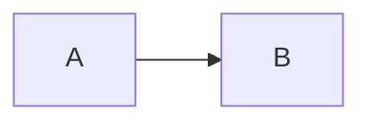

# Feature corpus

A paragraph with **bold**, *italic*, ~~strike~~, `inline code`, ==a highlight== and a [link](https://example.com/a?b=1).

Wikilinks: [[topic-writing]], an alias [[person-luca-rossi|Luca]] and a path [[type/note]].

Inline math $E = mc^2$ next to text, and a block:

$$
\int_0^1 x^2 \, dx = \frac{1}{3}
$$

> [!note] Remember
> Callouts keep their type and title.

> [!warning]
> A callout without a title, with a [[topic-writing|wikilink]] inside.

> A plain quote.

## Lists

- First
  - Nested one
    - Nested two
  - Back to one
- Second

1. Step one
2. Step two
   1. Sub step

- [ ] Open task
- [x] Done task

## Table

| Name | Role | Notes |
| --- | --- | --- |
| Ada | Engineer | Writes `code` |
| Luca | Founder | Links [[area-building]] |

## Code

```ts
export function add(a: number, b: number): number {
  return a + b // 1 * 2 * 3
}
```

```
no language
```



```tldraw id="board-1" height="520"
{}
```

---


Last line.
